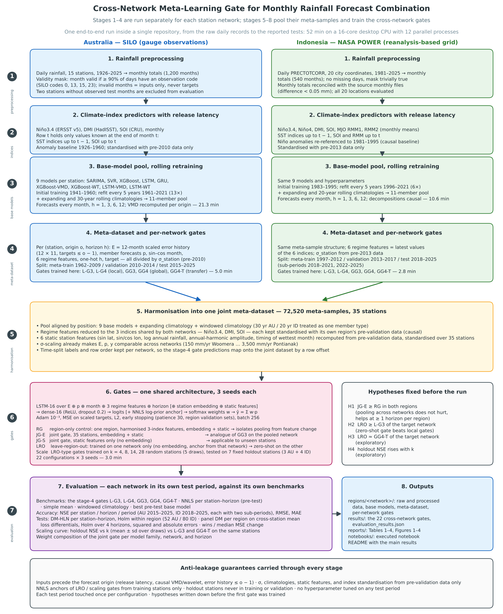

# Cross-Network Meta-Learning for Monthly Rainfall Forecast Combination (Australia SILO + Indonesia NASA POWER)

Is the combination rule learned by a cross-station meta-learner gate general across climate regimes and data types? This experiment trains one gate jointly on two station networks — 15 SILO rain-gauge stations in Australia (1926–2025; monsoonal, arid, and mid-latitude climates) and 20 NASA POWER grid locations in Indonesia (1981–2025; equatorial and monsoonal) — and tests it in three ways: joint training (does pooling across networks help each region?), leave-region-out transfer (does a gate trained on one network beat the local gates of the other, zero-shot?), and a scaling curve (does holdout accuracy grow with the number of pooled stations?). The two networks share ENSO, the IOD, and the Australian–Indonesian monsoon as large-scale drivers, so the test is transfer across climate regimes, data sources (gauges vs reanalysis grid), and record lengths (100 vs 45 years) — not across unrelated climates. Haeruddin, Purwanto, Muljono, Edi Noersasongko.

**Everything runs inside this repository, from the raw daily rainfall records to the reported tests.** Stages 1–4 build each network separately under `regions/<network>/` (monthly aggregation with a validity mask, climate indices with release latency, nine base models with rolling refits plus two rolling climatologies, the meta-dataset, and the per-network gates that serve as benchmarks); stages 5–8 pool the two meta-datasets and train, evaluate, and report the cross-network gates. The complete run took 52 minutes on a 16-core desktop CPU with 12 parallel processes.

The per-network protocol is that of the two single-network studies, whose repositories hold the same raw data and the published single-network results:

- Australia: [cross-station-meta-learning-monthly-rainfall](https://github.com/syamhaeruddin/cross-station-meta-learning-monthly-rainfall) (test 2015–2025, 13 evaluated stations)
- Indonesia: [cross-station-meta-learning-indonesia-rainfall](https://github.com/syamhaeruddin/cross-station-meta-learning-indonesia-rainfall) (test 2018–2025, 20 locations)



*The method from the raw daily rainfall records to the reported outputs. Stages 1–4 run separately for each network; stages 5–8 pool their meta-samples.*

## Design

| | Setting |
|---|---|
| Stages 1–4, per network | Daily rainfall → monthly totals with a validity mask; climate indices aligned to their release latency; nine base models (SARIMA, SVR, XGBoost, LSTM, GRU, XGBoost-VMD, XGBoost-WT, LSTM-VMD, LSTM-WT) trained on an initial period and retrained every five years, plus expanding and windowed rolling climatologies (11-member pool); the meta-dataset (12-month scaled error history, member forecasts, sin–cos of the target month, regime features, one-hot horizon, target) and the per-network gates L-G3, L-G4, GG3, GG4, GG4-T |
| Harmonisation | 11-member pool aligned by position (9 base models + expanding climatology + windowed climatology: 30 years AU, 20 years ID); regime features reduced to the three indices available in both regions (Niño3.4, DMI, SOI; standardised with each region's pre-validation data); six static station features recomputed and standardised over all 35 stations; time splits remain those of each region |
| Gate | One shared architecture in stages 4 and 6: LSTM-16 over the error history, dense-16, softmax weights, Adam 10⁻³, MSE on scaled targets, L2, early stopping (patience 30) on the region validation periods, 3 seeds averaged |
| **RG** | Region-only gate with the harmonised (3-index) features, station embedding + static features — the control that separates the pooling effect from the feature change |
| **JG-E / JG-S** | Joint gates trained on all 35 stations, with station embedding + static features (JG-E) or static features only (JG-S) |
| **LRO** | Leave-region-out: trained on one network only (no embedding, NNLS anchor pooled over the training region), tested on the other |
| **Scaling curve** | 7 fixed holdout stations (Darwin, Brisbane, Woomera; Banda Aceh, Jakarta, Banjarmasin, Ambon); transfer gates trained on k = 4, 8, 14, 28 stations drawn at random from the other 28 (5 draws, 1 for k = 28) |
| Benchmarks | The per-network gates of stage 4 (L-G3, L-G4, GG3, GG4, GG4-T) plus NNLS stacking, the simple mean, the windowed climatology, and the best pre-test base model |
| Tests | Per-station DM-HLN tests with Holm correction within region (52 / 80 combinations); panel DM tests per region with Holm over the four horizons, squared and absolute errors |
| Hypotheses (fixed before the run) | H1 JG-E ≥ RG in both regions; H2 LRO ≥ L-G3 of the target region; H3 LRO ≈ GG4-T of the target region (exploratory); H4 holdout NSE increases with k (exploratory) |

## Main results

Mean NSE across the evaluated stations of each region (test periods 2015–2025 and 2018–2025; gates averaged over three seeds).

| Horizon | Australia: L-G3 | GG3 | GG4-T | RG | JG-S | JG-E | LRO (ID→AU) | | Indonesia: L-G3 | GG3 | GG4-T | RG | JG-S | **JG-E** | LRO (AU→ID) |
|---|---|---|---|---|---|---|---|---|---|---|---|---|---|---|---|
| 1 | 0.326 | **0.340** | 0.338 | 0.339 | 0.338 | 0.340 | 0.340 | | 0.388 | 0.407 | **0.420** | 0.403 | 0.407 | 0.412 | 0.399 |
| 3 | 0.329 | **0.340** | 0.332 | 0.337 | 0.336 | 0.337 | 0.337 | | 0.350 | 0.367 | **0.380** | 0.361 | 0.367 | 0.373 | 0.358 |
| 6 | 0.323 | **0.333** | 0.329 | 0.330 | 0.328 | 0.328 | 0.323 | | 0.320 | 0.339 | 0.334 | 0.334 | 0.349 | **0.352** | 0.339 |
| 12 | 0.320 | **0.329** | 0.324 | 0.328 | 0.326 | 0.325 | 0.325 | | 0.320 | 0.342 | 0.343 | 0.335 | 0.341 | **0.345** | 0.330 |
| mean | 0.324 | **0.336** | 0.331 | 0.333 | 0.332 | 0.333 | 0.331 | | 0.345 | 0.364 | 0.369 | 0.358 | 0.366 | **0.371** | 0.357 |

Benchmarks: NNLS 0.325 (AU) / 0.330 (ID), simple mean 0.321 / 0.323, windowed climatology 0.300 / 0.314, best pre-test base model 0.323 / 0.323.

- **H1 — joint training (JG-E vs RG): holds in Indonesia, not in Australia.** In Indonesia the joint gate beats the region-only gate of identical architecture and features in 52 of 80 location–horizon combinations, with panel Holm-adjusted *p* = 0.005 and 0.004 at horizons 1 and 3 months (0.070 at 6 months) and *p* ≤ 0.005 at all four horizons with absolute errors; it gains +0.013 NSE on average. In Australia the two are indistinguishable at 1–6 months and the joint gate is slightly worse at 12 months on absolute errors (*p* = 0.033 for the region-only gate); the most accurate Australian gate remains the regional global gate GG3 with its six regional indices. The benefit of pooling therefore goes to the network with the smaller meta-sample (27,040 samples in Indonesia against 45,480 in Australia) — the asymmetry expected if sample size is the mechanism.
- **Feature change (RG vs GG3).** Reducing the regime features from six to three costs accuracy in Indonesia (RG 0.358 vs GG3 0.364, *p* = 0.006 / 0.002 / < 0.001 / 0.025 in favour of GG3) and nothing in Australia, where the three shared indices are the regional set. The joint gate recovers that loss with pooled samples alone: JG-E (three indices) matches GG3 (six indices) on squared errors in Indonesia (*p* ≥ 0.60), beats it on absolute errors at 1–6 months (*p* = 0.013 / 0.047 / 0.047), and reaches the highest mean NSE of all in-sample gates (0.371).
- **H2 — leave-region-out transfer (LRO vs L-G3): holds at short horizons.** A gate that has never seen the target network beats that network's local gates: Indonesia (gate trained on Australia) 49 of 80 wins, *p* < 0.001 and 0.007 at 1 and 3 months; Australia (gate trained on Indonesia) 32 of 52 wins, *p* = 0.020 at 1 month. At 6 and 12 months the advantage disappears. LRO also beats the simple mean and the climatology at most horizons in both networks, and NNLS in neither.
- **H3 — transfer across vs within network (LRO vs GG4-T).** In Australia the two are equivalent (*p* ≥ 0.86 on squared errors). In Indonesia the within-network transfer gate GG4-T remains better at 1, 3, and 12 months (*p* < 0.001, 0.004, 0.046): transfer from a different climate regime and data type is real but weaker than transfer from the same network.
- **H4 — scaling curve.** Holdout NSE rises monotonically with the number of pooled training stations: 0.339 ± 0.011 (k = 4), 0.348 ± 0.005 (8), 0.349 ± 0.003 (14), 0.350 (28), against 0.328 for the local gates of the same seven stations and 0.286 for NNLS; the spread across draws shrinks from 0.011 to 0.003. The gain saturates after about eight stations — the benefit of pooling comes from escaping the single-station sample size, not from ever more stations.
- **Weights.** The joint gate derives different compositions per network from one parameter set: at horizon 1 it gives 0.36 of the weight to the climatology members and 0.24 to SARIMA in Australia, against 0.20 and 0.42 in Indonesia; in both the climatology share grows with the horizon (Table 4).
- **Effect size.** Median MSE reductions are small (JG-E vs L-G3: +1.1% AU, +2.2% ID; vs NNLS: +1.1% AU, −0.0% ID); the contribution is consistency across stations and transferability across networks, not a large gain — a limit set by the high error correlation of the pool members.

Full tables and figures: `reports/` (Tables 1–4 as CSV, Figures 1–4, `summary.md`); all comparisons, per-station tests, weights, and training epochs: `results/evaluation_results.json`.

## Repository layout

```
├── notebooks/Cross_Continent_Gate_Experiment.ipynb   # runs the whole experiment and shows the tables and figures
├── src/
│   ├── regions/<network>/ # stages 1-4 per network: prepare_data, climate_indices, base_models_rolling, meta_gate, common, run_all
│   ├── run_regions.py     # driver for stages 1-4 (both networks, from the raw data)
│   ├── common.py          # network settings, pool, DM-HLN test, Holm correction
│   ├── harmonise.py       # stage 5: joint meta-dataset (data/joint/meta_joint.npz)
│   ├── gates.py           # stage 6: RG, JG-E, JG-S, LRO, scaling-curve gates
│   ├── evaluate.py        # stage 7: NSE, DM tests (Holm), panel tests, weights, scaling curve
│   ├── report.py          # stage 8: tables and figures
│   └── run_all.py         # regions | joint | gates | all
├── regions/australia/     # data/raw (SILO), data/processed, results (base models, meta-dataset, per-network gates)
├── regions/indonesia/     # data/raw (NASA POWER), data/processed, results
├── data/joint/            # harmonised joint meta-dataset
├── results/               # pred_*.npz of every cross-network gate, evaluation_results.json
├── reports/               # Tables 1-4 (CSV), Figures 1-4 (PNG), summary.md
├── requirements.txt
└── README.md
```

## How to run

Python 3.13 is recommended. The raw data of both networks is part of this repository, so nothing else is needed.

```bash
python -m venv .venv
# Windows: .venv\Scripts\activate      Linux/macOS: source .venv/bin/activate
pip install -r requirements.txt
jupyter lab notebooks/Cross_Continent_Gate_Experiment.ipynb
```

The notebook has two switches. With both `False` (default) it re-evaluates the stored outputs in about a minute; `RETRAIN_GATES = True` retrains the 22 cross-network gate configurations (≈ 3 minutes with 12 parallel processes); `RETRAIN_BASE_MODELS = True` reruns stages 1–4 from the raw data as well (≈ 40 minutes more). Command-line equivalent:

```bash
python src/run_all.py regions     # stages 1-4 for both networks (existing outputs are skipped)
python src/run_all.py joint       # stage 5 (harmonisation) + stage 6 (cross-network gates)
python src/evaluate.py            # stage 7
python src/report.py              # stage 8
# or simply: python src/run_all.py all
```

Parallel processes: environment variable `WORKERS` (default 6, 12 was used here); gate seeds: `SEEDS` (default `1,2,3`).

### Runtime of the reported run (16-core desktop CPU, `WORKERS=12`)

| Stage | Australia | Indonesia | Joint |
|---|---|---|---|
| 1–2 preprocessing and climate indices | < 1 min | < 1 min | — |
| 3 base-model pool (9 models × stations, rolling refits) | 21.3 min | 10.6 min | — |
| 4 meta-dataset and per-network gates | 5.0 min | 2.8 min | — |
| 5–6 harmonisation and 22 cross-network gates | — | — | 3.0 min |
| 7–8 evaluation, tables, figures | — | — | ≈ 1 min |

## Anti-leakage notes

Every input to a meta-sample precedes the forecast origin: climate indices enter with their release latency, VMD is recomputed at every origin on past data only, the wavelet is causal, the error history uses only targets at or before *o* − 1, and σ, the climatologies, the static features, and the index standardisation come from pre-validation data only. In addition: the static-feature standardisation uses only pre-validation data of each region; the NNLS anchor of the leave-region-out and scaling-curve gates is fitted on the training stations only; the holdout stations of the scaling curve never enter training or validation; no hyperparameter is tuned on any test period, and each region's test period is touched once per configuration.

## Contact

Haeruddin, Faculty of Computer Science, Universitas Dian Nuswantoro, Semarang, and Universitas Internasional Batam — haeruddin@uib.ac.id
